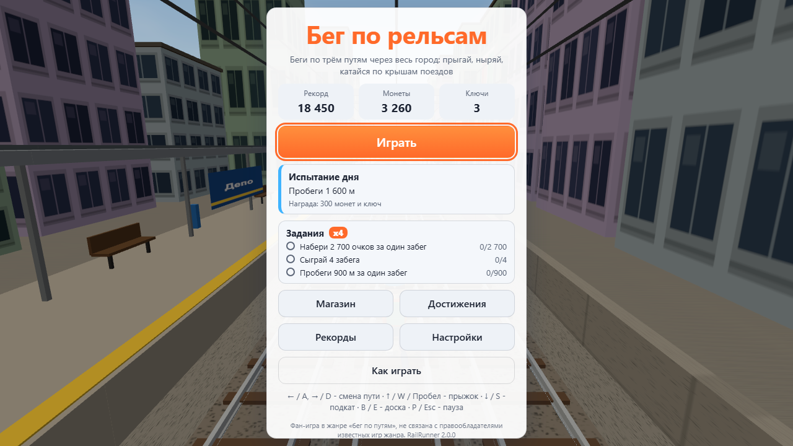
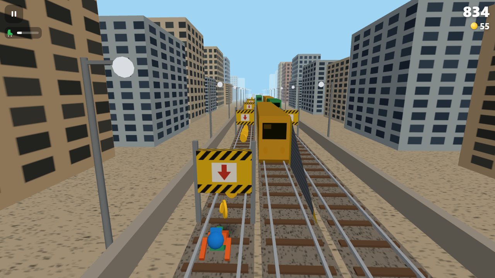
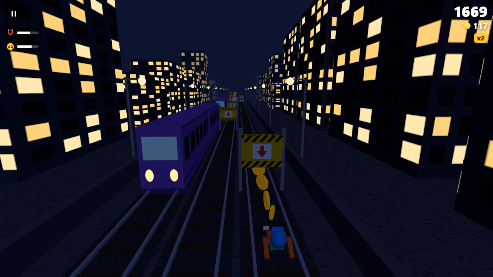
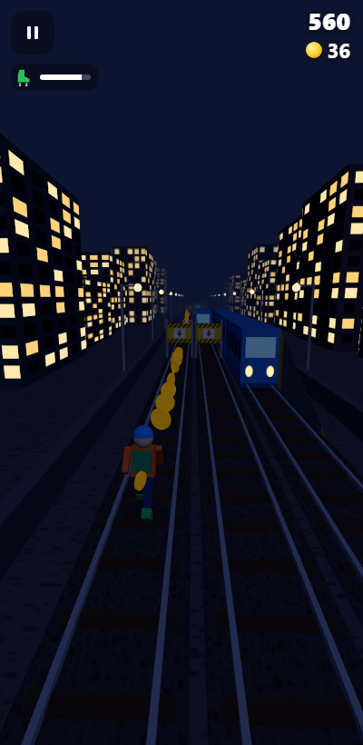
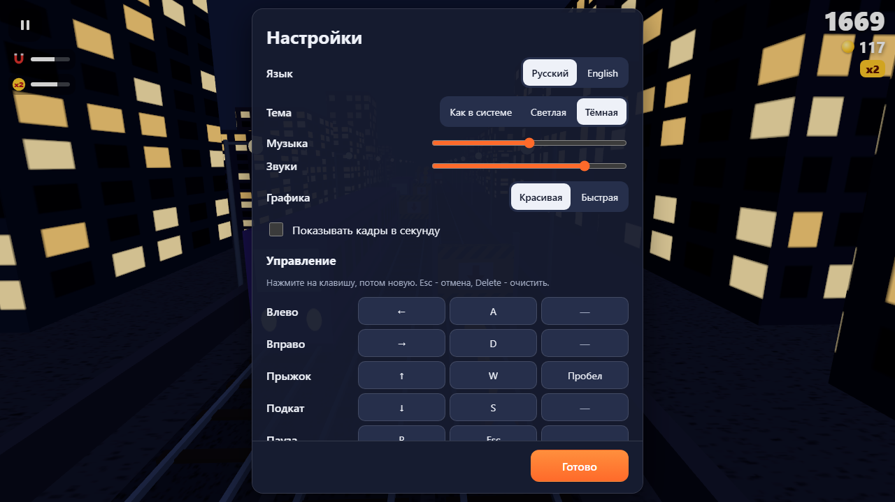
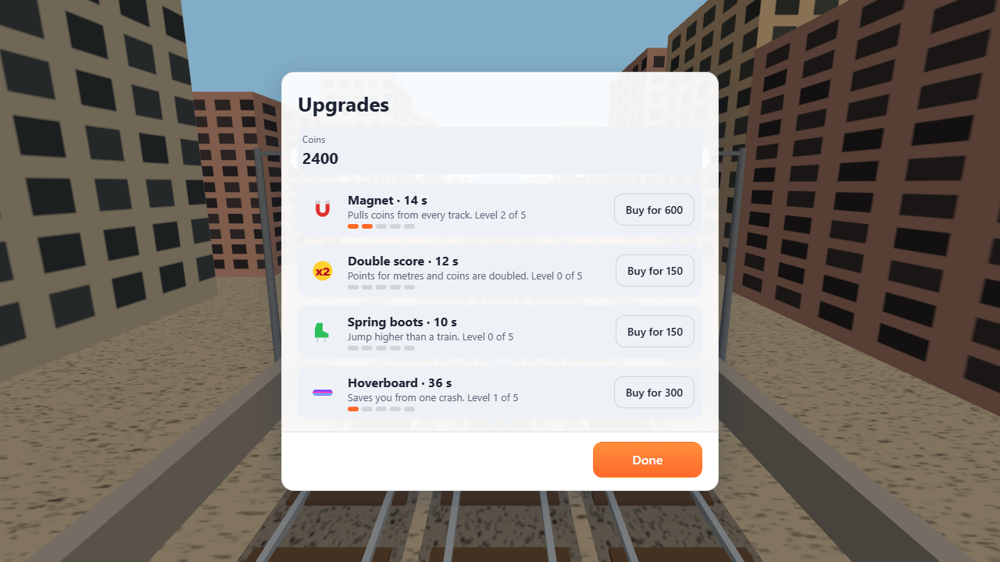

# Rail Runner

**English** · [Русский](README.ru.md)

An endless 3D run along three railway tracks: jump over hurdles, slide under bars, dodge
oncoming trains, run up onto carriage roofs and collect coins. The speed grows with every
metre. It runs in the browser and as a Windows app.

- **Play in the browser:** https://alexalesha.github.io/RailRunner/
- **Download for Windows:** [latest release](https://github.com/ALEXalesha/RailRunner/releases/latest) -
  `RailRunner-<version>-Setup.exe` (installer) or `RailRunner-<version>-Portable.exe` (no install)

A fan game in the track-runner genre. The graphics, sounds and names are its own; it is not
affiliated with the rights holders of the genre's known games.



| Day | Night |
| --- | --- |
|  |  |

| Phone | Settings | Upgrades |
| --- | --- | --- |
|  |  |  |

## How to play

| Action | Keyboard (default) | Finger or mouse |
| --- | --- | --- |
| Left / right | ← → or A D | swipe left or right, tap the left or right third of the screen |
| Jump | ↑, W or Space | swipe up, tap the middle |
| Slide | ↓ or S | swipe down |
| Pause | P or Esc | the button in the top left corner |

- **Hurdle** (low, red and white) - jump over it.
- **Bar** (a yellow and black board with an arrow down) - slide under it.
- **Train** - go around it on another track. A train with a ramp can be run up and along its roof.
- **Oncoming train** with its headlights on moves towards you and sounds its horn - leave its track early.
- **A side hit** throws you back to the track you came from and you stumble; a second hit soon after ends the run.
- Slide in the air drops you fast; a jump pressed just before landing happens on landing.
- Every key can be reassigned in the settings (three keys per action); the hints in the game
  always name the keys that are assigned now.

### Power-ups

| | What it does | How long |
| --- | --- | --- |
| Magnet | pulls coins from every track | 10 s |
| Double score | points for metres and coins are doubled | 12 s |
| Spring boots | jump higher than a train | 10 s |
| Hoverboard | saves you from one crash (then a short invulnerability) | 30 s |

Coins are kept between runs and buy **upgrades**: each level (up to five) makes a power-up
last 20 % longer. Prices: 150, 300, 600, 1200, 2400.

### More

- Themes: system, light (day) and dark (night with lit windows).
- English and Russian; the browser's language by default.
- Sound and music are synthesised on the fly (Web Audio), there are no sound files. Music and
  sound volume have separate sliders.
- The best score, coins, upgrades and settings are saved (in the browser - in its storage under
  the key `railrunner:save`, in the app - in its data folder).
- The game pauses by itself when the window is minimised or the tab is hidden; it resumes after
  a 3-2-1 countdown.
- "Pretty" or "Fast" graphics (for weak laptops), a frame counter in the settings.
- The Windows app remembers the window's size and place; F11 - full screen.

## Windows app

The installer installs the game for the current user (no administrator rights), with shortcuts
on the desktop and in the Start menu. Silent install: `RailRunner-<version>-Setup.exe /S`.
The portable version runs without installing.

## For developers

Everything is in the repository, nothing is loaded from the network while playing: three.js
0.170.0 (MIT) lies in `web/vendor/three.js` as a plain script, so the page also works from disk
(`file://`).

```
web/index.html      the page
web/js/core.js      game rules without screen or keyboard: generator, physics, collisions, score
web/js/render.js    the 3D view (three.js), it only draws
web/js/app.js       screens, keys, swipes, saving, the game loop
web/js/audio.js     synthesised sounds and music
web/js/i18n.js      texts in RU/EN
electron/           the Windows app shell
tests/unit/         laws of the rules (node:test)
tests/web/          player scenarios in headless Chromium (Playwright)
tests/app/          laws of the Electron app (the window is invisible in tests)
tools/mutate.js     checks of the checks: breaks the rules one by one, the laws must fail
```

```
npm ci
npm test            # 34 laws of the rules, ~25 s
npm run test:web    # 19 page scenarios, ~3 min
npm run test:app    # 3 laws of the app, ~1 min
npm run mutate      # 27 mutants, ~10 min
npm run screens     # README frames
npm run dist        # dist/RailRunner-<version>-Setup.exe and -Portable.exe
```

**Why there is always a way through.** The world is built in rows. In every row the generator
keeps a "safe" track: only passable things stand on it (nothing, a hurdle, a bar or a train with
a ramp). The safe track moves by at most one track per row, and only where it is free early
enough - the lane-change time plus reaction. Oncoming trains move at a fraction of the player's
speed, so the generator knows exactly where they meet the player. Two independent laws check
this: an inspection of the finished world (300 worlds of 4 km) and an autopilot with the real
physics that runs 4 km in 60 worlds. The same autopilot runs behind the menu.

## License

MIT, see [LICENSE](LICENSE). three.js - MIT (`web/vendor/three.LICENSE`).
