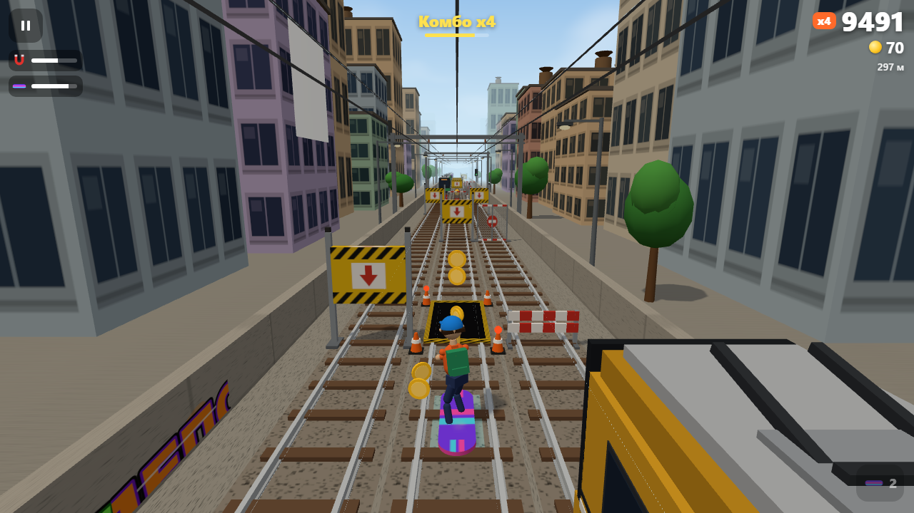
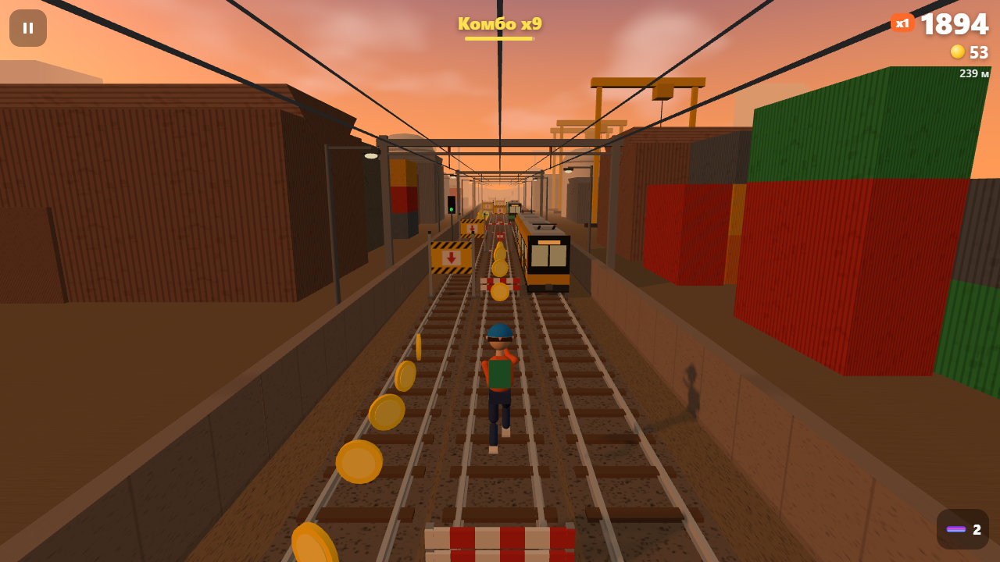
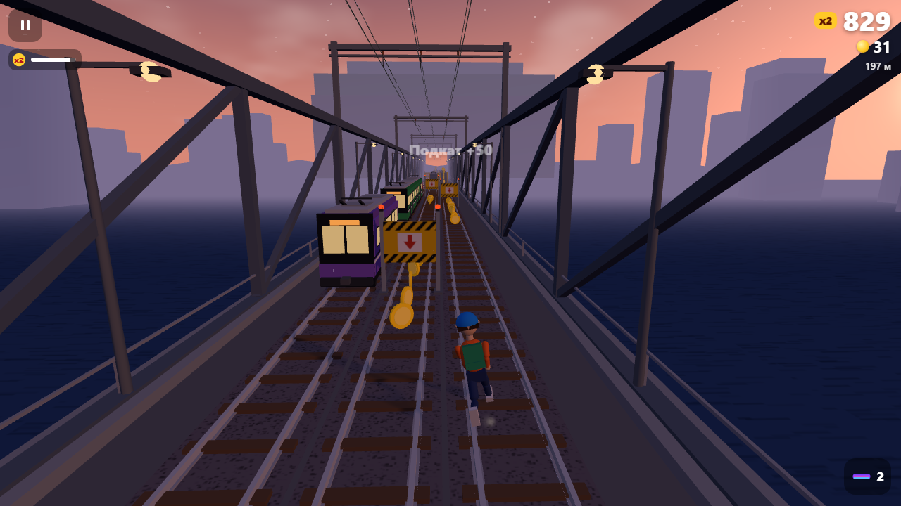
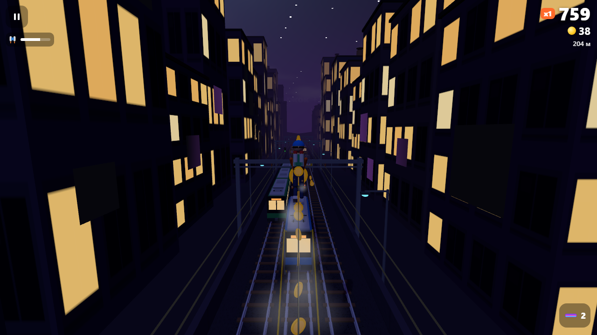
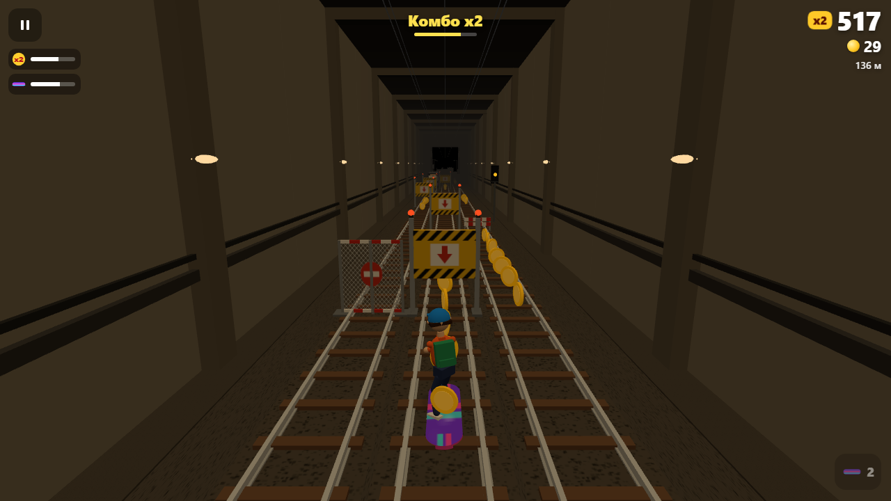
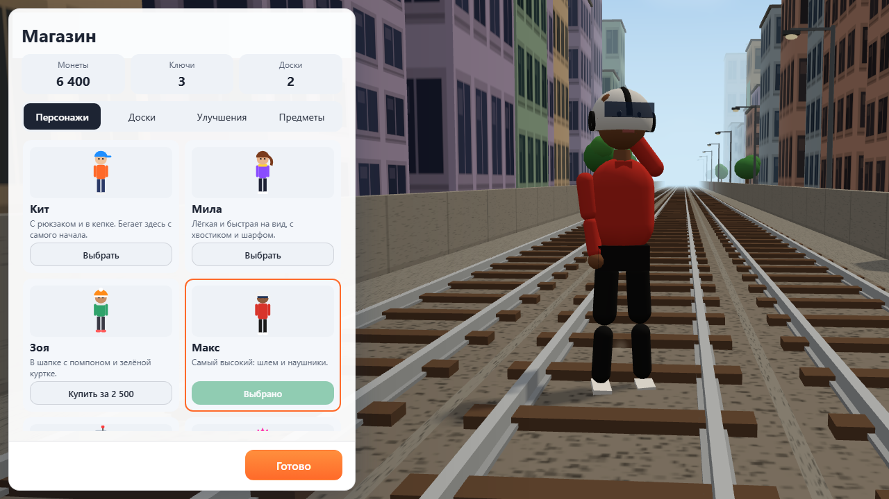
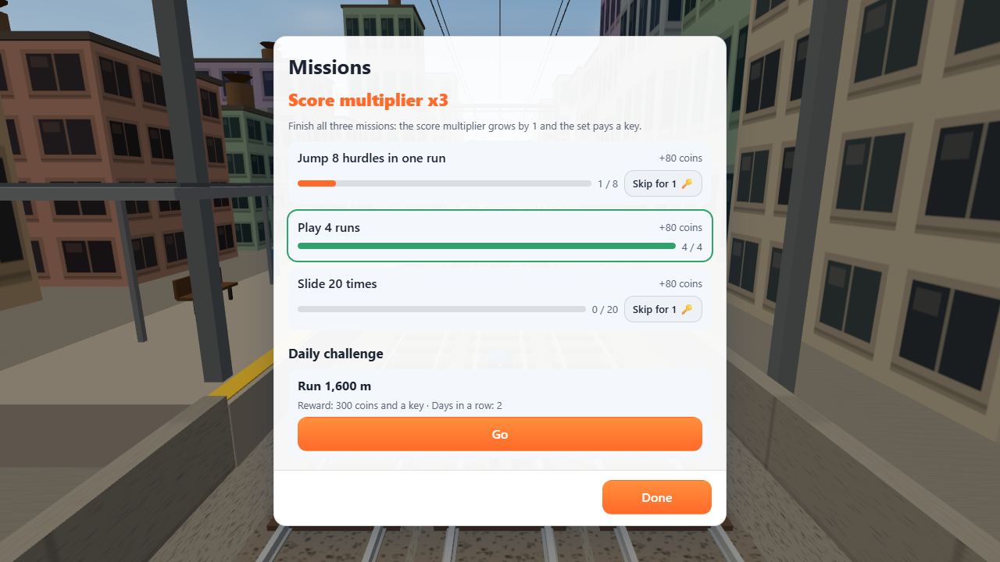
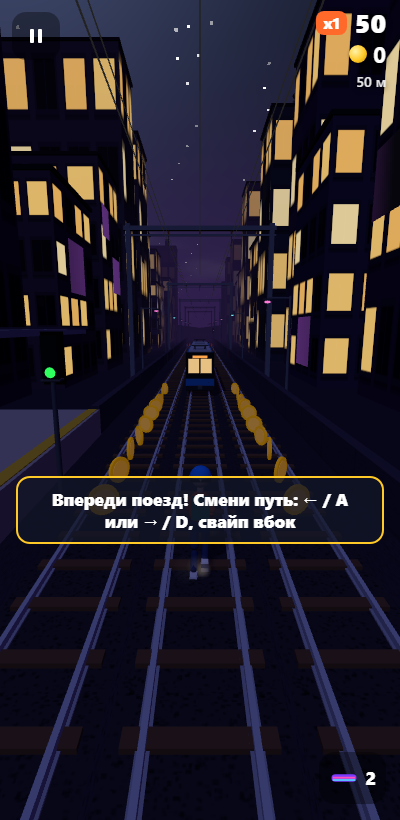

# Rail Runner

**English** · [Русский](README.ru.md)

An endless 3D run along three railway tracks across a whole city: through the streets by day,
the industrial zone at sunset, over the bridge across the river, through the tunnel and under
neon signs at night. Jump hurdles, slide under bars, go around fences and pits, dodge oncoming
trains, run along carriage roofs and fly a jetpack. Six characters, hoverboards, missions with a
score multiplier, a daily challenge, achievements and records. It runs in the browser and as a
Windows app.

- **Play in the browser:** https://alexalesha.github.io/RailRunner/
- **Download for Windows:** [latest release](https://github.com/ALEXalesha/RailRunner/releases/latest) -
  `RailRunner-<version>-Setup.exe` (installer) or `RailRunner-<version>-Portable.exe` (no install)

A fan game in the track-runner genre. The graphics, characters, sounds, music and names are its
own - all drawn and synthesised by code; it is not affiliated with the rights holders of the
genre's known games.


| City by day | Industrial zone at sunset |
| --- | --- |
|  |  |

| Bridge over the river | Neon city, jetpack |
| --- | --- |
|  |  |

| Tunnel, hoverboard | Shop | Missions | Phone: tutorial |
| --- | --- | --- | --- |
|  |  |  |  |

## How to play

| Action | Keyboard (default) | Finger or mouse |
| --- | --- | --- |
| Left / right | ← → or A D | swipe left or right, tap the left or right third of the screen |
| Jump | ↑, W or Space | swipe up, tap the middle |
| Slide | ↓ or S | swipe down |
| Hoverboard | B or E | the button at the bottom right |
| Pause | P or Esc | the button in the top left corner |

The first run starts with a short **tutorial**: before every new obstacle time almost stops and
waits for the right action; a crash during a lesson does not end the run. The tutorial can be
played again from the settings.

### Obstacles

- **Hurdle** (low, red and white) - jump over it.
- **Bar** (a yellow and black board with an arrow down) - slide under it.
- **Fence** (a net with a sign) - only go around it; with super sneakers you can jump it.
- **Repair pit** (a dark hole with cones) - jump over it; a slide will not help.
- **Trains**: standing ones; with a ramp - run up onto the roof and along the cars, hopping onto
  the train on the next track; **oncoming** ones with headlights sound the horn; **freight** trains
  roll away and you catch up with them.
- **A side hit** throws you back to the track you came from and you stumble; a second hit soon after is a crash.
- **Clipping an edge** is a knock, not a crash: the toes on the top of a hurdle after a late jump, its
  edge on landing, a corner after a late dodge - if no more than 10 % of the obstacle's height or width
  is touched. You stumble for 2.5 s; a second knock or hit in that time is a crash. The hitboxes of
  hurdles, bars and fences are the size of their visible models.

### Power-ups

| | What it does | How long |
| --- | --- | --- |
| Magnet | pulls coins from every track | 10 s |
| Double score | points for metres, coins and tricks are doubled | 12 s |
| Super sneakers | jump higher than a train or a fence | 10 s |
| Hoverboard | saves you from one crash | 30 s |
| Jetpack | flight over the trains along a trail of coins, soft landing | 7 s |

Every upgrade in the shop (up to level five) makes a power-up last 20 % longer. The time left of
each power-up is a bar in the top left corner.

### Score, combo and multiplier

- Points come for metres, coins and **tricks**: a hurdle jump, a slide, a pit jump, a roof run,
  a hop from roof to roof, a last-moment dodge of a train. Tricks in a row (no more than 3 seconds
  apart) build a **combo**: every next trick is worth more.
- **Missions**: three at a time (say "collect 60 coins in one run", "jump 25 times"). Each pays
  coins; when all three are done, the **score multiplier** grows by 1 (up to x30) and you get a
  key. A mission can be skipped for keys.
- **Daily challenge**: one world and one goal for the whole day; the reward is 300 coins and a
  key, days in a row add a bonus.
- **Keys** continue a run after a crash: 1, then 2, 4, 8... Missing keys can be bought on the spot
  for coins. Keys sometimes lie on the tracks.
- **Achievements** (22, with badges) - 100 coins each. **Records**: the ten best runs and overall
  statistics.

### Shop

- Characters: Kit, Mila, Zoe, Max, Bolt the robot and Nova - each with their own build, clothes and
  hair. Any of them can be looked at before buying: in the shop the character stands on the tracks
  and turns around.
- Hoverboards: Classic, Flame, Wave, Stars, Neon, Gold.
- Power-up upgrades, keys (500 coins) and spare hoverboards (200 coins). A new player starts with
  three hoverboards. The start menu shows the stock of hoverboards next to the coins and keys.

### More

- Five districts follow each other during a run, and with them the time of day (day, sunset,
  dusk, night, morning), the light, the sky with stars and clouds, the weather (rain, fog) and
  the music change. Around the tracks: houses with windows, trees, stations with names, signals,
  catenary, graffiti and billboards, warehouses, chimneys with smoke, cranes, the bridge truss,
  neon signs.
- "Juice": particles (dust, sparks, coin glitter, jetpack flames, smoke), camera shake, flashes,
  slow motion at a crash, a smooth camera.
- Sound and music are synthesised on the fly (Web Audio): every district has its own chords; the
  tempo and the number of parts grow with the speed.
- Settings: language (RU/EN), theme (with the dark theme a run starts at night), graphics quality
  ("Auto", high, medium, low), shadows, particles, camera shake, music and sound volume, every key
  (three per action, the hints name the assigned ones), a frame counter.
- "Auto" watches the frame time: below 45 frames a second the quality goes down; with room to
  spare above 55 it comes back.
- Everything is saved (in the browser under the key `railrunner:save`, in the app in its data
  folder). A 1.0 save is picked up with nothing lost: best score, coins, upgrades and settings.
- The game pauses by itself when the window is minimised or the tab is hidden; it resumes after
  a 3-2-1 countdown.
- The Windows app remembers its window size and place; F11 - full screen.

## The Windows app

The installer installs the game for the current user (no administrator rights needed) with
shortcuts on the desktop and in the Start menu. Silent install: `RailRunner-<version>-Setup.exe /S`.
The portable version runs without installing.

## For developers

Everything is in the repository, nothing is loaded from the network during the game: three.js
0.170.0 (MIT) lies in `web/vendor/three.js` as a plain script, so the page also works from disk
(`file://`).

```
web/index.html      the page with all screens
web/js/core.js      the rules of a run without the screen: districts, generator, physics, tricks, jetpack, continue, tutorial
web/js/meta.js      progress between runs: the save (and the 1.0 migration), shop, missions, daily challenge, achievements
web/js/gfx.js       graphics helpers: vertex-coloured geometry, textures by code, pools, sky, particles, rain
web/js/scenery.js   the districts and their light, the tracks and everything around them
web/js/actors.js    trains, obstacles, coins, power-ups, the runner on joints, the hoverboard
web/js/render.js    light, weather, particles, camera, quality
web/js/app.js       screens, keys, swipes, saving, tutorial, the loop, "Auto" quality
web/js/audio.js     synthesised sounds and music
web/js/i18n.js      RU/EN texts (with word forms for numbers)
electron/           the Windows app shell
tests/unit/         laws of the rules and the progress (node:test)
tests/web/          player scenarios in headless Chromium (Playwright, no windows)
tests/app/          laws of the Electron app (the window is invisible in tests)
tools/mutate.js     testing the tests: breaks the rules one by one, the laws must fail
```

```
npm ci
npm test            # 65 laws of the rules and the progress, ~40 s
npm run test:web    # 39 page scenarios, ~20 min
npm run test:app    # 3 app laws, ~1 min
npm run mutate      # 84 mutants, ~50 min (node tools/mutate.js --check only checks the breakages fit)
npm run screens     # README frames
npm run dist        # dist/RailRunner-<version>-Setup.exe and -Portable.exe
```

The page address takes parameters for tests and frames: `?seed=N` - the run's world,
`?manual=1` - time only moves by `RailRunner.advance(seconds)`, `?date=YYYY-MM-DD` - the day of
the challenge, `?district=industrial` - the starting district, `?preserve=1` - keep the picture
for screenshots.

**Why there is always a way through.** The world is built in rows. In every row the generator
has a "safe" track: on it there is only what can be passed (nothing, a hurdle, a pit, a bar, a
train with a ramp or - from a roof - the roof of a train on the next track that is already under
the player). The safe track moves by at most one track per row and only where it is free in
advance - for the time of a lane change plus reaction. Oncoming and freight trains move at a
share of the player's speed, so the generator knows exactly where they meet. Independent laws
check it: a check of the finished world (300 worlds of 4 km), an autopilot with the real physics
(4 km on 60 worlds, with every power-up, with a jetpack every 300 m) and the tutorial on 25
worlds. The same autopilot runs behind the menu.

## License

MIT, see [LICENSE](LICENSE). three.js - MIT (`web/vendor/three.LICENSE`).
